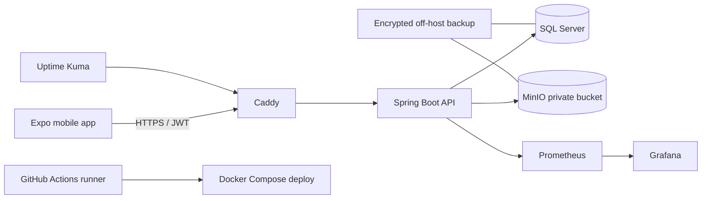

# Architecture

## Decisions

- Modular monolith API: one deployable Spring Boot service with domain-oriented packages and one transactional database.
- REST is versioned under `/api/v1`; identifiers are UUIDs; dates are ISO 8601 UTC; company timezone affects display only.
- SQL Server is authoritative. Mobile SQLite is a bounded encrypted-at-rest cache and durable operation queue.
- Offline mutations have a client-generated operation UUID and entity version. The server records operations idempotently.
- Manager-owned assignment data uses server-wins. Checklist scalar answers use latest valid write. Photos/incidents are additive. Overlapping time is held for review.
- Objects are private in MinIO. Clients receive short-lived signed URLs; metadata and access control remain in SQL Server.
- A single Ubuntu VM is the initial production failure domain. Docker Compose isolates proxy, application, data and monitoring networks. Proxmox and off-host backups provide recovery.

## System context

## API conventions

- Error body: `{ code, message, fieldErrors, timestamp, requestId }`.
- Pagination: `page`, `size`; response `{ items, page, size, totalElements, totalPages }`.
- Sorting: `sort=field,asc`; filters use stable query parameters.
- Optimistic updates require `version`; conflict returns HTTP 409.
- Soft-delete/archive is represented by `deleted_at`; collection reads exclude it by default.

